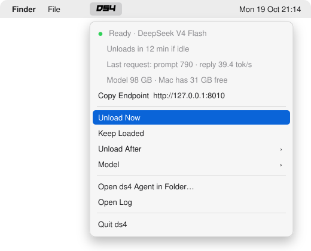
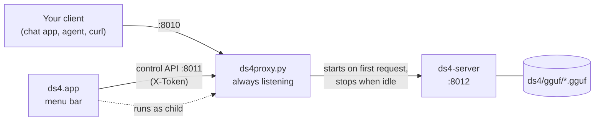

<div align="center">

# ds4-menu

**A macOS menu bar app and lazy proxy for [antirez/ds4](https://github.com/antirez/ds4).**<br>
A local DeepSeek, GLM or Qwen endpoint that's always there, and only holds onto your RAM while something is using it.

[](#install)
[](#requirements)
[](menubar/DS4Menu.swift)
[](ds4proxy.py)
[](LICENSE)

<picture>
  <source media="(prefers-color-scheme: dark)" srcset="docs/menu-dark.svg">
  
</picture>

</div>

---

## Why

`ds4-server` is fast, but a loaded model takes **~90 GB of RAM**, and you don't want that
held all day just in case. ds4-menu keeps an endpoint listening on `127.0.0.1:8010` all the time
at almost no cost:

- 🪶 **Lazy loading.** The first request starts `ds4-server` and is forwarded as soon as the model is ready: a few seconds warm, about 20 s cold.
- 💤 **Idle unload.** After 15 minutes without traffic the server stops and the RAM goes back to macOS. A request that's still prefilling counts as traffic. Choose *Keep Loaded* to pin it.
- 🔀 **Model switching from the client.** A request whose `"model"` names another family (`deepseek-…`, `glm-…`, `qwen-…`) swaps the loaded gguf first, so you can pick the model in your chat app as usual.
- 💾 **SSD streaming.** Models bigger than ~80% of RAM automatically get `--ssd-streaming` and a 32K context. Disk-only tables, such as Qwen3.8's n-grams, don't count toward that.
- 🧠 **RAM-aware.** Before loading, it waits for enough free memory, for example while another local model is unloading, and returns a clear `503` if there isn't enough. *Load Now* overrides that.
- 🤝 **Plays nicely with `ds4-agent`.** ds4 allows one process at a time, so the menu shows *Paused* while the agent runs. *Open ds4 Agent in Folder…* unloads the server and opens the agent in Terminal for you.
- 📡 **Streaming untouched.** The proxy pipes raw TCP, so SSE streams, OpenAI `/v1/chat/completions` and Anthropic-style `/v1/messages` all pass straight through.

## How it works



The menu bar app runs the proxy as its own child process. That's deliberate: launchd jobs
can't read `~/Documents`, where ds4 and its models usually live, but a child process inherits the
app's Documents permission.

## Requirements

- An Apple Silicon Mac on macOS 13 or later, with enough RAM for your model (96 GB+ for DeepSeek or GLM, 64 GB for Qwen3.8 Flash Next)
- A built checkout of [antirez/ds4](https://github.com/antirez/ds4) with at least one model in `ds4/gguf/`
- Xcode Command Line Tools (`xcode-select --install`), for `swiftc` and `/usr/bin/python3`

## Install

```sh
git clone https://github.com/adamtty/ds4-menu.git
cd ds4-menu
./install.sh
```

This builds `~/Applications/ds4.app`, signs it ad hoc, and registers a LaunchAgent so it starts at
login. The first time it runs, macOS asks for access to your Documents folder. Click **Allow**.

If your ds4 checkout isn't at `~/Documents/code-work/ds4`:

```sh
DS4_DIR=~/src/ds4 ./install.sh
```

Re-run `./install.sh` after changing any source file. The app is only rebuilt when the Swift
code, icon or installer changes. Each rebuild looks like a new app to macOS, so it asks for
Documents access again. Edits to the proxy alone are simply copied into place.

```sh
./install.sh uninstall     # stops and removes the app; settings and log are kept
```

## Use it

Point any OpenAI- or Anthropic-compatible client at the proxy:

```sh
curl http://127.0.0.1:8010/v1/chat/completions \
  -H 'Content-Type: application/json' \
  -d '{"model": "deepseek-v4-flash", "messages": [{"role": "user", "content": "Hi!"}]}'
```

*Copy Endpoint* in the menu copies `http://127.0.0.1:8010/v1`.

### The menu bar icon

| Icon | Meaning |
| --- | --- |
| **DS4** bright | Model loaded and ready |
| **DS4** dimmed | Idle; the model loads on the next request |
| **DS4** `12s` | Loading, with the time so far |
| **DS4** `agent` | Paused because another ds4 process (e.g. `ds4-agent`) is running |
| **DS4** `⚠︎` | The last load failed. Open the menu for the reason |
| **DS4** `✕` | The proxy isn't answering. The app restarts it with backoff |

## Configuration

Settings live in `~/.local/share/ds4-menu/settings.json`. The menu writes most of them for you:

| Key | Default | What it does |
| --- | --- | --- |
| `model` | the gguf `ds4flash.gguf` points at | The model to load, a file name in `ds4/gguf/` |
| `pinned` | `false` | *Keep Loaded*: never unload when idle |
| `idle_min` | `15` | Minutes without traffic before unloading |
| `models` | `{}` | Per-model overrides, e.g. `{"file.gguf": {"ctx": 65536, "args": ["--mtp"]}}` |
| `agent_args` | `[]` | Extra arguments for *Open ds4 Agent in Folder…*, e.g. `["--ctx", "262144"]` |

Without an override, resident models get a 100K context and SSD-streamed ones get 32K.

### Control API

The menu talks to the proxy on `127.0.0.1:8011`. Every request needs the `X-Token` header from
`~/.local/share/ds4-menu/token` (mode `600`, regenerated at each start).

| Method | Path | Body |
| --- | --- | --- |
| `GET` | `/status` | — |
| `POST` | `/start` | — (loads now, ignoring the free-RAM check) |
| `POST` | `/stop` | — |
| `POST` | `/settings` | `{"pinned": bool, "idle_min": int, "model": "file.gguf"}` |

## Files

| Path | What |
| --- | --- |
| [`ds4proxy.py`](ds4proxy.py) | The proxy and control API. Python standard library only |
| [`menubar/DS4Menu.swift`](menubar/DS4Menu.swift) | The AppKit status item, compiled with `swiftc` (no Xcode project) |
| [`menubar/make-icon.swift`](menubar/make-icon.swift) | Turns the wordmark into the `logo.png` / `logo@2x.png` template images |
| [`install.sh`](install.sh) | Build, sign, install and uninstall |
| `~/.local/share/ds4-menu/proxy.log` | The proxy and ds4-server log (*Open Log* in the menu) |

Regenerate the icon with:

```sh
swift menubar/make-icon.swift menubar/ds4-logo-source.png menubar/
```

## Troubleshooting

- **"not enough free RAM"**: something else is holding memory, e.g. another local model. Free it, or use *Load Now* to load anyway.
- **Port 8010 already in use**: something else is using it, e.g. a manually started `ds4-server`. Stop it, and the app restarts the proxy on its own.
- **Stuck on "Paused"**: a `ds4` process is still holding `/tmp/ds4.lock`. Quit it, or check *Open Log* to see which one.
- **The first request after a while is slow**: macOS evicted the model from its file cache, so the load reads it from SSD again.

## Credits

Built on [ds4](https://github.com/antirez/ds4) by Salvatore Sanfilippo and the ds4 authors
(MIT). The DS4 wordmark belongs to that project. The lazy-load and idle-unload idea comes from
[oMLX](https://github.com/jundot/omlx).

## License

[MIT](LICENSE)
